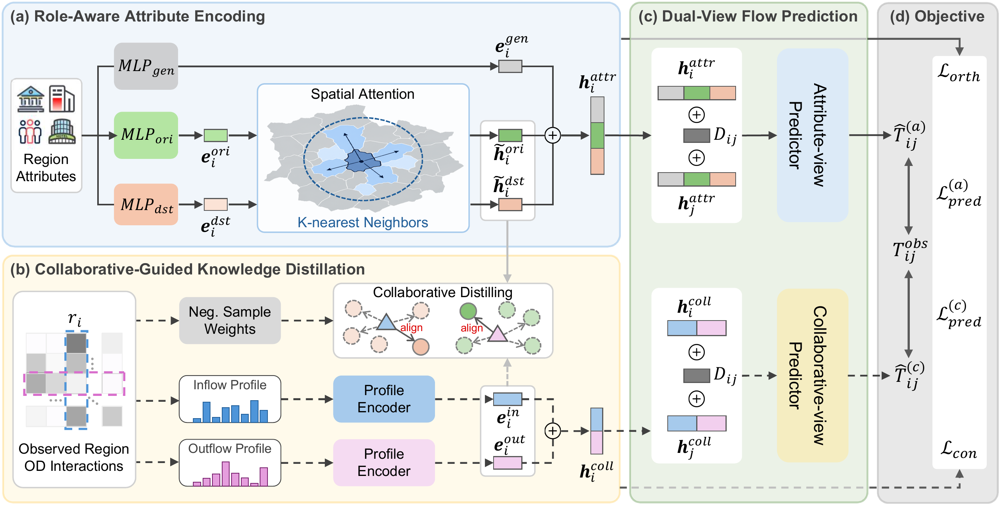

# CoLD

Collaborative Knowledge Distillation for Cold-Start Commuting Flow Prediction.



## Files

```text
CoLD_minimal/
├── data/
│   ├── NYCNTA/           # NYC: 262 regions
│   ├── SF/               # 242 regions
│   └── DC/               # 206 regions
├── figure/
│   ├── framework.png
│   └── framework.pdf
├── model/
│   ├── __init__.py
│   ├── data.py           # Region splits, OD profiles and neighbors
│   ├── model.py          # Encoders and predictors
│   ├── train.py          # Single-fold training
│   ├── cross_validate.py # Five-fold training and aggregation
│   └── metrics.py
├── README.md
└── requirements.txt
```

Each city contains `attr.npy` (N × 48), `dis.npy` (N × N), and `od.npy` (N × N).

## Install

Use Python 3.10+ and run from this folder:

```bash
pip install -r requirements.txt
```

## Train

Run five-fold cross-validation on all three cities:

```bash
python -m model.cross_validate --cities NYCNTA SF DC --output-dir ../CoLD_runs --device cuda:0
```

Use `--device cpu` or `--device mps` when CUDA is unavailable. To train one fold:

```bash
python -m model.train --city-path data/NYCNTA --fold 0 --seed 0 --neighbor-k 20 --output-dir ../CoLD_nyc_fold0 --device cpu
```

Five disjoint test folds are generated automatically with split seed 0. Each
region is tested once; the remaining regions are divided into train/validation
sets at 7:1. Training seed for fold f is f by default. Training uses only
train-to-train flows, and neighbors come only from training regions. Testing
uses train-to-test, test-to-train and test-to-test pairs, excluding self pairs.

Defaults: d=60, temperature=0.5, Adam learning rate 1e-3, weight decay 1e-5,
lambda_con=2, lambda_orth=0.5, validation-MSE patience 20 and maximum 300 epochs.
Batch size 8 means eight origin rows, each with all other training destinations.
The cross-validation runner uses K=20 for NYC and K=30 for SF/DC. Profiles use
log1p; prediction targets remain on the original flow scale. Both predictors
use ReLU outputs; their final linear weights start at zero and biases at one.

The output directory stores checkpoints, logs, exact splits, test predictions,
and metrics. Cross-validation reports the arithmetic mean and sample standard
deviation of the five fold metrics. These runs generate new measured results;
they are not guaranteed to reproduce the manuscript's original table values.
